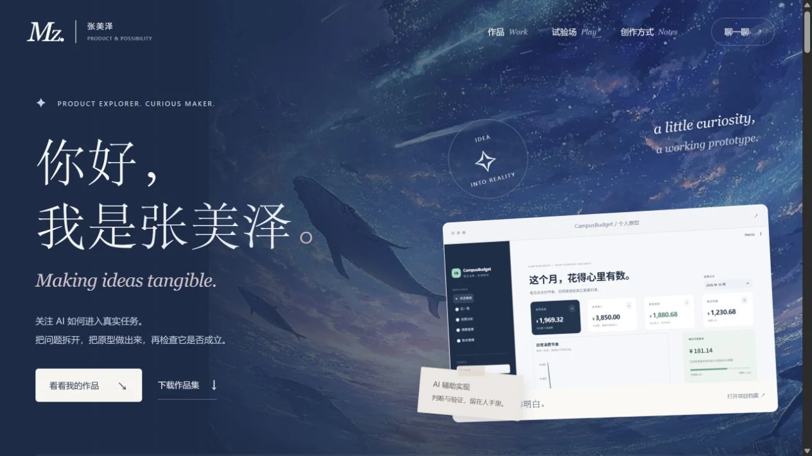

# 张美泽 · 把好奇变成作品

[打开个人网站](https://rachelmeize-ui.github.io/) · [下载项目作品集](https://rachelmeize-ui.github.io/assets/meize-project-portfolio.pdf) · [Gmail 联系](mailto:rachel.meize@gmail.com)

## 精选项目

| 项目 | 可以展开的内容 |
| --- | --- |
| [AI 能力评测](https://rachelmeize-ui.github.io/#case-evaluation) | 回答记录、错误归因、歧义探针与评测范围 |
| [CampusBudget](https://rachelmeize-ui.github.io/#case-campus) | AI 辅助原型、保存前确认、日期误判修复与预设测试 |
| [FinFair](https://rachelmeize-ui.github.io/#case-finfair) | 金融信息对照、原文追溯与团队分工 |
| [金融项目汇报 Skill](https://rachelmeize-ui.github.io/#case-skill) | 事实分级、版本状态、V1/V2 与场景复测 |
| [银行客户营销响应预测](https://rachelmeize-ui.github.io/#case-marketing) | 离线模型评估、指标解释与客户触达建议 |

网站包含星海流星、开场缩放、滚动计数、桌面三段展开面板，以及项目筛选、案例档案、日期解析交互演示、PDF 下载与手机端导航。支持暂停星空动效、键盘切换与减少动态效果。每个案例均说明项目范围、个人或团队分工，以及当前验证情况。

## 联系

主要邮箱：rachel.meize@gmail.com

备用邮箱：2024290206@szu.edu.cn

## 本地预览

直接打开 `index.html`，或运行 `python -m http.server 8766 --bind 127.0.0.1` 后访问本机地址。网页使用原生 HTML、CSS 和 JavaScript，无需安装前端依赖。GSAP / ScrollTrigger / Lenis 从公开 CDN 加载，仅用于增强动效；加载失败或开启减少动态效果时，正文、数字、筛选、案例与演示仍可使用。

## 材料说明

项目原型截图使用模拟数据。星海背景与特征工程页面来自作者提供的项目 PPT，仅作网页格式优化，未声明为原创美术作品。没有上传原 PPT、原始客户数据或私密账本。夜海、蓝色蝴蝶与发光海浪背景来自作者提供的参考截图，经网页格式压缩并通过 CSS 蒙板、透明度与模糊处理融入页面。源码、页面与作品集使用 AI 协作制作。

## 交互与文字

参考作者提供的 React Bits TextPressure、MaskedHeading、StrokeText、FoldText、StarBorder、JellyRadio、CardSwap、Galaxy / Particles 示例，以原生 CSS、SVG、Canvas 和 JavaScript 重新组织适合本网站的效果。没有加入 React 或构建步骤。首页项目卡片由访客手动切换；触屏与减少动态效果均保留静态可读内容。暂停星空动效会同步暂停星光边框和背景粒子。
