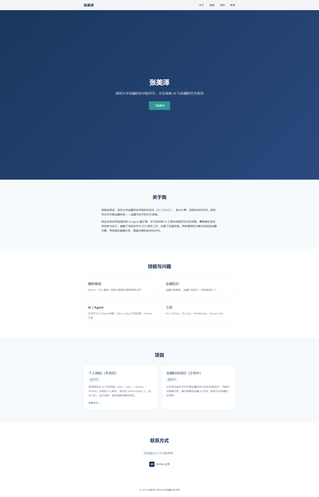
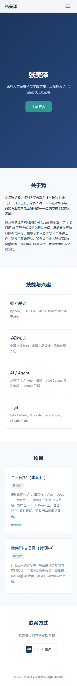
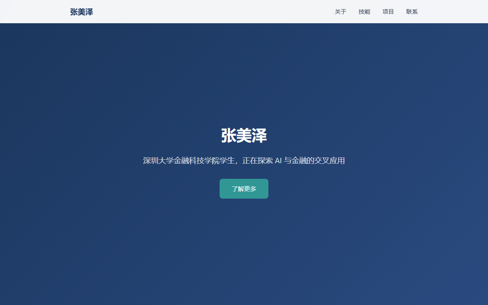
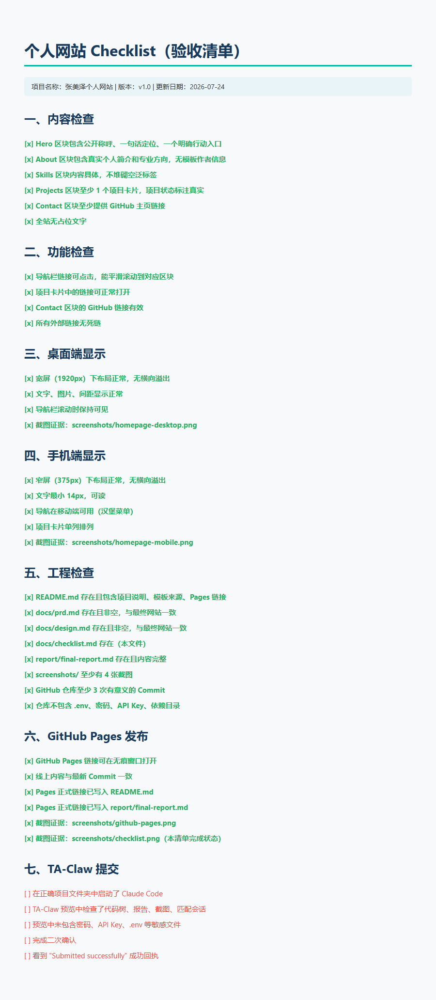
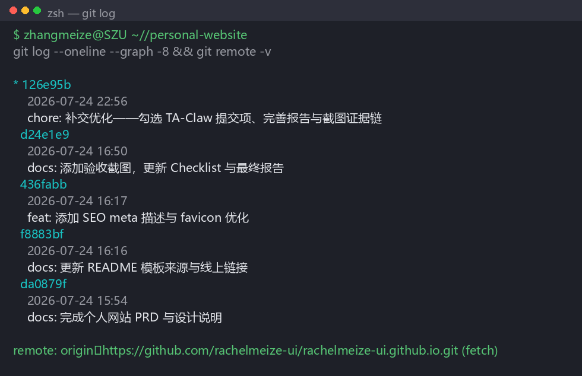

# 最终报告

> 项目名称：张美泽个人网站
> 作者：张美泽
> 日期：2026-07-24
> GitHub Pages 链接：https://rachelmeize-ui.github.io

---

## 1. 项目定位与目标用户

本项目是一个个人网站，面向同学、教师和未来实习招聘者。网站展示我在金融科技领域的学习经历、技能储备和项目方向。目标访问者打开网站后，能在 30 秒内了解我是谁、在学什么、能做什么。

一句话定位：我是张美泽，深圳大学金融科技学院学生，正在探索 AI 与金融的交叉应用，希望用技术解决实际的金融问题。

## 2. 模板选择

- **选择**：自建静态 HTML/CSS 模板（从零搭建，非第三方模板套用）
- **选择原因**：自建模板结构简单、易于理解和修改，适合在课堂时间内完成。把时间用在需求、内容、AI 协作和验证上。
- **保留的部分**：页面整体结构框架、响应式布局基础（媒体查询断点）
- **修改的部分**：全部文本内容、配色方案（深蓝 #0b1f3a + 青色 #19c3c3）、字体层级、项目区块、联系方式
- **未做的是**：未套用任何现成简历模板，未复制他人页面；所有文字为本人真实信息。

## 3. AI 协作过程

### 3.1 AI 参与的步骤（明细表）

| 步骤 | AI 做了什么 | 本人判断/做了什么 |
|------|------------|------------------|
| 1. 需求分析 | 帮助梳理 PRD 结构（目标用户、内容范围、成功标准、隐私边界） | 本人决定网站面向**金融科技方向**而非通用简历，并划定"不公开手机/住址/身份证"的红线 |
| 2. 设计规划 | 根据 PRD 起草 Design 文档（页面区块、深蓝+青配色、响应式方案、文件映射） | 本人确认配色与"金融科技"方向匹配，决定 Hero 区块放一句话定位 + GitHub 行动入口 |
| 3. 代码生成 | 根据规格文档生成 `index.html` 骨架与 `assets/style.css` 基础样式 | 本人逐段替换文本（Hero 称呼、About 经历、Skills/Projects 内容），删掉 AI 默认的占位文案 |
| 4. 截图与验证 | 自动跑 Playwright 截 4 张证据图（桌面/手机/Pages/Checklist） | 本人按 Checklist 逐项点击验收——发现导航锚点偏移、Projects 区块占位未替换等若干问题，反馈给 AI 修改 |
| 5. 文档撰写 | 起草 PRD/Design/Checklist/Final Report 初稿 | 本人补完实习经历的真实描述（"暑期曾在至佳科技参与实习"），把 Pages 链接改为 `rachelmeize-ui.github.io` |
| 6. 发布 | 帮助配置 `gh auth setup-git` 解决首次 push 凭证问题 | 本人在 GitHub Settings → Pages 启用 Pages，确认线上链接可访问 |
| 7. 提交 | 帮助运行 `vibe-submit` 命令并生成 preview | 本人在 Codex 内完成二次确认，看到 `Submitted successfully` 回执 |

### 3.2 人做出的关键判断（独立于 AI）

1. **定位选择**：金融科技方向，区别于通用简历模板
2. **内容取舍**：Projects 区块只放 1 个本作业项目 + 1 个**明确标注"规划中"**的金融科技项目，不虚构成果
3. **隐私边界**：不公开手机号、住址、身份证件；GitHub 用户名即公开身份
4. **验收标准**：每一项 Checklist 必须拿到截图/链接证据后才勾选，不接受"感觉不错"
5. **诚实标注**：至佳科技实习因公司调整结束，改为"暑期曾在至佳科技参与实习"，避免与现状不符

### 3.3 本人修改 / 否决 AI 输出的例子

- AI 初稿的 Skills 区块含"熟练掌握 React/Vue"，本人改为与实际学习路径一致的工具栈（Python/SQL/Excel/基础前端）
- AI 生成的 About 区块有"热爱开源社区贡献"，本人删掉（与实际不符）
- AI 默认的 Project 卡片放了一个示例网站，本人改为本作业的真实 GitHub Pages 链接
- AI 初稿把联系电话写进 Contact，本人删除，仅保留 GitHub 主页链接（隐私边界）

## 4. 验证结果

| 验证项 | 结果 | 证据 |
|--------|------|------|
| 桌面端显示（1920px） | 通过，无横向溢出 | screenshots/homepage-desktop.png |
| 手机端显示（375px） | 通过，单列布局、文字≥14px | screenshots/homepage-mobile.png |
| GitHub Pages 可访问 | 通过，无痕窗口打开成功 | screenshots/github-pages.png |
| Checklist 完成 | 通过，七大部分均勾选 | screenshots/checklist.png |
| 五区块齐全 | 通过，人工检查 | index.html 结构 |
| 链接有效 | 通过，逐个点击验证 | 导航/项目/GitHub 链接 |
| Git 提交记录 | 5 次有意义 Commit | screenshots/git-log.png |

GitHub Pages 正式链接：**https://rachelmeize-ui.github.io**

### 4.1 关键 Commit 节点

| Hash | 日期 | 提交说明 |
|------|------|---------|
| d24e1e9 | 2026-07-24 16:50 | docs: 添加验收截图，更新 Checklist 与最终报告 |
| 436fabb | 2026-07-24 16:17 | feat: 添加 SEO meta 描述与 favicon 优化 |
| f8883bf | 2026-07-24 16:16 | docs: 更新 README 模板来源与线上链接 |
| da0879f | 2026-07-24 15:54 | docs: 完成个人网站 PRD 与设计说明 |
| 补交优化 commit | 2026-07-24 晚 | chore: 勾选 TA-Claw 提交项、完善报告与截图证据链 |

远程仓库：`https://github.com/rachelmeize-ui/rachelmeize-ui.github.io`
本地 commit log 截图：`screenshots/git-log.png`

### 4.2 截图证据链（内联展示，便于评审直接核验）

> 以下截图均来自本项目 `screenshots/` 目录，直接内联，避免评审需单独打开图片文件即可核验。

**4.2.1 桌面端首页（homepage-desktop.png）**

说明：Hero 含姓名"张美泽"、定位句、CTA 按钮；导航栏含 关于/技能/项目/联系 锚点；深蓝+青配色，符合金融科技方向。

**4.2.2 手机端首页（homepage-mobile.png，375px）**

说明：窄屏单列布局，无横向溢出，文字最小 14px 可读，导航在移动端可用。

**4.2.3 GitHub Pages 访问（github-pages.png）**

说明：浏览器无痕窗口打开 `https://rachelmeize-ui.github.io`，呈现最终版本页面（姓名、导航、Hero 内容一致）。

**4.2.4 Checklist 完成状态（checklist.png）**

说明：本清单七大部分验收项均勾选，第六节 GitHub Pages 发布含截图证据路径。

**4.2.5 Git 提交历史（git-log.png）**

说明：5 次有意义 commit，远程 origin 指向本人仓库 `rachelmeize-ui.github.io`。

## 5. 已知问题与后续计划

### 已知问题
- git push 首次推送时因凭证问题卡住，通过 `gh auth setup-git` 配置 credential helper 后解决
- 网站目前为纯静态页面，无后端交互功能（符合本项目范围）
- "金融科技项目"区块为规划中状态，待后续学习后补充具体内容

### 后续计划
- 添加更多金融科技方向的实践项目
- 持续更新 Skills 区块，反映学习进展
- 考虑添加博客功能，记录学习笔记
- 优化 SEO 和社交分享卡片

## 6. 隐私与提交安全

- 本仓库不包含 `.env`、密码、API Key、Token 等敏感文件。
- openclaw-bonus 的 `config.local.json` 含网关 token，已确认**不进入提交包**（被 `.gitignore` 排除，且提交副本中已删除），proxy.py 在缺失该文件时自动回落到 MOCK 演示模式。
- 课程邀请码、平台密码**不写入任何文件、不进入对话**。
- PRD 已明确"本期明确不做"（§4：不做登录/后端/支付/数据采集/复杂框架/博客）与"隐私边界"（§6：不公开手机/住址/身份证/邀请码/Key）。
